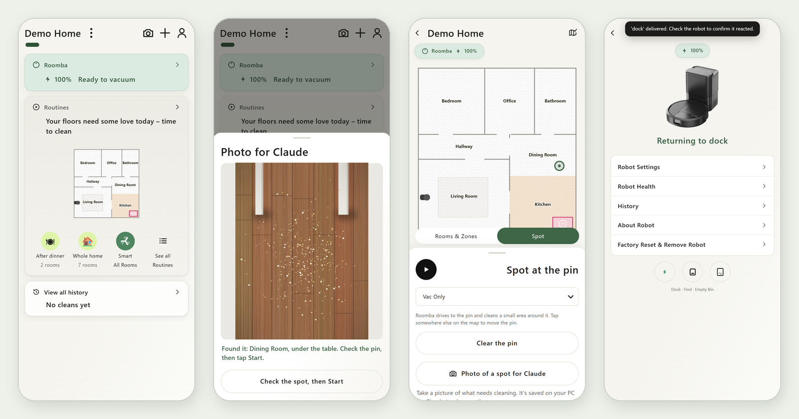
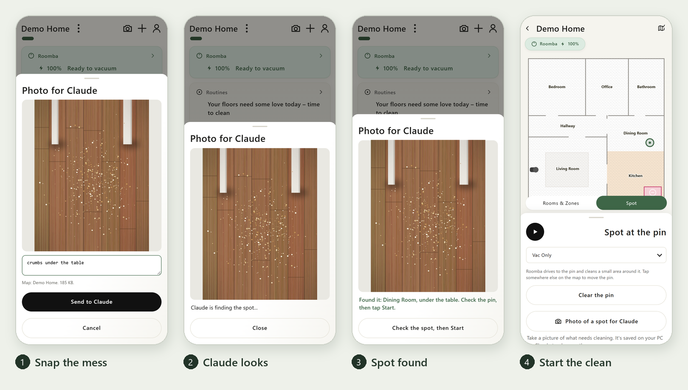
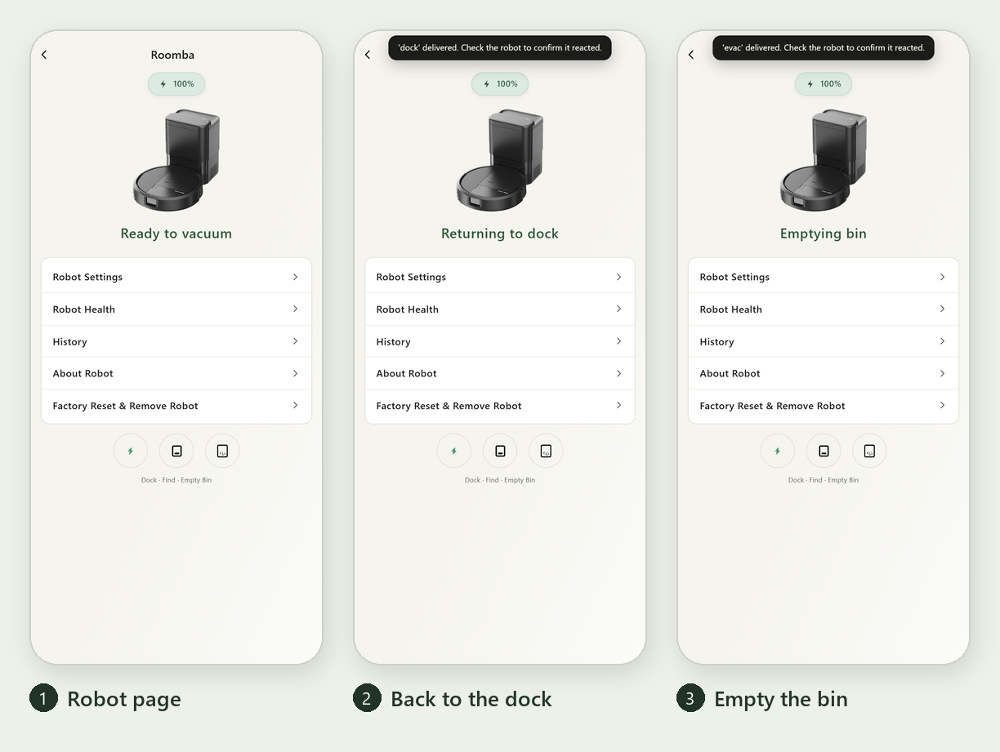

# Roomba

A home-grown, phone-friendly app for an iRobot Roomba (Prime / V4, cloud-only models), modeled on the official Roomba Home app. It runs on a Windows PC and you open it from your phone's browser. On top of the usual controls, it adds one trick the official app doesn't have: **take a photo of a mess, and Claude finds that spot on your map and sends Roomba there.**

<p align="center">
  
</p>

> The screenshots use a made-up demo home. No real house, map, or robot data is in this repo.

## Features

- **Photo spot clean.** Snap a picture of crumbs, dust, or a spill. The app sends it to your PC, Claude places it on your map, and Roomba cleans right there.
- **Return to dock and empty the bin.** One tap sends Roomba home, and another empties its bin into the Clean Base.
- **Clean everywhere or by room.** Pick rooms on the map, set suction, passes, and mopping for each, and watch progress live.
- **Routines and schedules.** Run, create, and edit routines (iRobot favorites) and schedules.
- **Map editing.** Rename, merge, and split rooms, add keep-out and no-mop zones, and rename or rotate maps.
- **Robot care.** Battery, part wear, cleaning history, Do Not Disturb hours, and robot settings.
- **Use it anywhere.** Open it from any phone on your Wi-Fi, or from anywhere over Tailscale, with a private link.

## Photo spot clean

<p align="center">
  
</p>

1. Tap the **camera** on Home (or **Photo of a spot for Claude** on the Spot tab) and take a picture. Add a note if you like, such as "crumbs under the table".
2. The photo is shrunk (which also drops its location data) and saved on your PC in `photos/`.
3. `photo_spot.py` asks [Claude Code](https://claude.com/claude-code) on the PC where the photo was taken, using your house atlas. It then checks the answer against the real map, making sure the spot is inside a room and not in a keep-out zone.
4. The spot shows up as a pin on the map. Tap **Start**, and Roomba drives over and cleans a small area around it. If `photo_spot.auto_send` is on in `app/settings.json`, it sends Roomba without waiting.

This needs no API key: it uses the Claude Code login already on your PC (`claude -p`), and Claude only gets read access to files.

**The house atlas.** Claude finds spots using `atlas/atlas.json`, a description of your home: each map's rooms, what's in them, and known spots with their map coordinates. You write it yourself, and it's gitignored so it stays private. A good way to build one is to walk through your home on video and have Claude describe each room against the app's map.

## Return to dock and empty the bin

<p align="center">
  
</p>

Tap the Roomba card on Home to open the robot page (during a clean, the card opens the live map instead). The buttons under the menu are **Dock**, **Find** (Roomba plays a sound), and **Empty Bin**. Empty Bin only appears for robots with an Auto-Empty dock. Ending a clean from the cleaning controls also sends Roomba back to its dock.

From a terminal, `roomba.bat dock` and `roomba.bat evac` do the same.

## Getting started

You'll need Windows, Python 3.11 or newer, and an iRobot account with a Prime / V4 Roomba. It talks to iRobot's cloud through the [roombapy-prime](https://github.com/johnnyh1975/roombapy-prime) library.

```bat
py -3 -m venv .venv
.venv\Scripts\pip install -r requirements.txt
roomba_app.bat
```

- On first run it asks for your iRobot email and password. After the first successful login you can save them in **Windows Credential Manager**, so they never land in a file.
- Open `http://127.0.0.1:8766/` on the PC. To use it from your phone, run with `--lan` (or set `"lan": true` in `app/settings.json`). The app prints a private link that includes a secret key. Keep that link private: anyone who can reach your PC with it can use the app.
- To start the app when you sign in to Windows, copy `startup/roomba_app_startup.cmd` into your Startup folder (Win+R, then `shell:startup`).
- For photo spot clean, install Claude Code on the PC and sign in, then write your `atlas/atlas.json`.

### Options

| Option | What it does |
| --- | --- |
| `--lan` / `--local` | Listen on your home network (needs the secret link), or this PC only |
| `--port N` | Port to listen on (default 8766) |
| `--fresh-logins` | Log in for every action instead of staying logged in |
| `--forget` | Remove the saved login, then ask for it again |
| `--new-key` | Replace the phone link's key, so old links stop working |

## What's in here

| Path | What it is |
| --- | --- |
| `app/server.py` | The web server, cache, and live status |
| `app/link.py` | Logging in to iRobot and keeping the connection |
| `app/actions.py` | Everything the app can ask the robot to do |
| `app/web/` | The page itself: `index.html`, `app.css`, and `js/` |
| `photo_spot.py` | Turns a phone photo into a spot clean with Claude Code |
| `roomba.py` | Send one command from a terminal (`start`, `dock`, `evac`, `spot`, ...) |
| `roomba_web.py` | The older, simpler web app |
| `roomba_login.py` | The iRobot login and Windows Credential Manager storage |
| `decomp/` | Notes from comparing the official app's protocol with the library |

## Privacy and security

- Your iRobot login and the phone link's key live in Windows Credential Manager, never in the repo.
- Photos, the house atlas, map dumps (`app/debug/`), and other personal data are gitignored.
- Every request needs the page's secret, which stops other websites from pressing buttons for you.

## Disclaimer

This is a personal project. It isn't made, endorsed, or supported by iRobot. Roomba and iRobot are trademarks of iRobot Corporation. Use it at your own risk.
